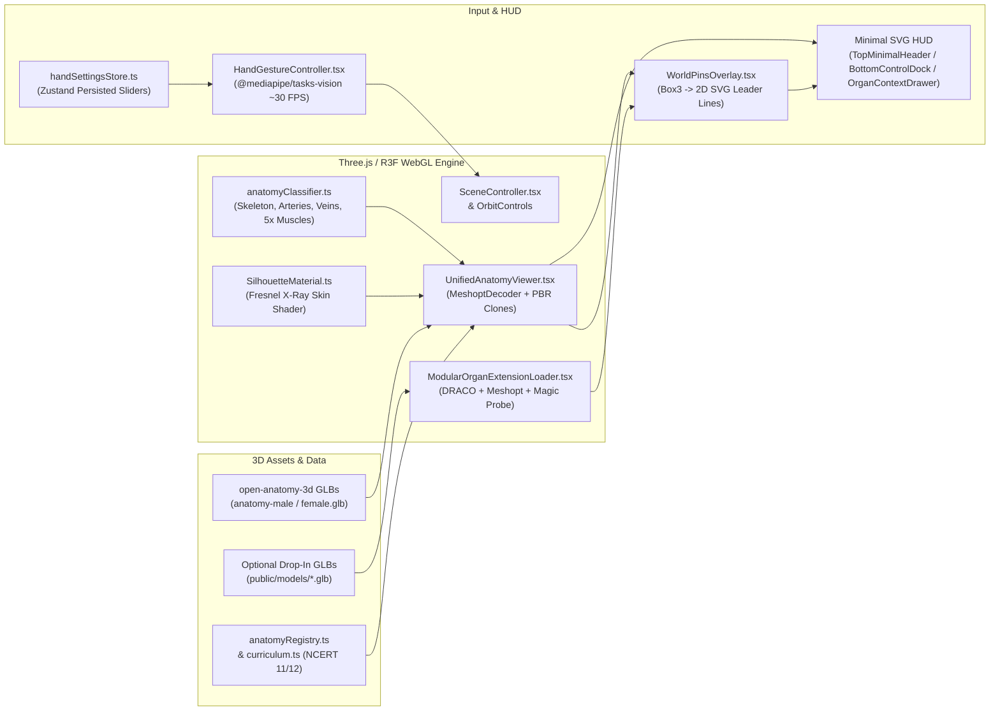

# Inside the Human Body — Unified 3D Anatomy Atlas

> **Interactive WebGL Medical & NCERT Biology (Classes 11 & 12) Workstation**  
> Powered by `open-anatomy-3d` unified Meshopt GLBs, Three.js PBR material bifurcation, world-space `Box3` SVG leader lines, and opt-in MediaPipe hand-gesture navigation.

---

## Product Vision

**Inside the Human Body** transforms static 2D textbook diagrams into an unobstructed, touchless-capable 3D anatomical laboratory built for **NCERT Class 11 & Class 12 Biology** students, NEET aspirants, and medical learners.

Instead of stitching mismatched organ models with fragile manual offsets, the entire male (`128` meshes) and female (`133` meshes) anatomy shares a **single unified `(0, 0, 0)` coordinate space** at strict `1:1:1` scale—wrapped inside a translucent Fresnel X-Ray skin envelope and paired with a minimal, inline-SVG dark glassmorphic HUD.

### Highlights at a Glance

- **Unified Male & Female 3D Models:** `147` cataloged structures (`135` named meshes + `12` joint hotspots) from `open-anatomy-3d`, decoded with `EXT_meshopt_compression`.
- **Zero-Leak Layer Isolation:** Strict node classification ensures toggling **Skeleton** hides 100% of bilateral bones (`femur_l`, `femur_r`, axial & appendicular skeleton) cleanly.
- **Vascular & Muscular PBR Bifurcation:** Per-mesh cloned `MeshPhysicalMaterial` instances color-code **12 Arteries** (crimson `#dc2626`) vs. **10 Veins** (cobalt `#2563eb`) and bifurcate **Muscles** into 5 anatomical regions with an interactive sub-legend.
- **Direct NCERT Biology Book Links:** Every organ, bone, vessel, and nerve maps to its exact **Class 11** (`kebo1`) or **Class 12** (`lebo1`) chapter on `ncert.nic.in/textbook.php`.
- **World-Space `Box3` Pins & 60 FPS SVG Leader Lines:** Imperative `useFrame` screen projection anchors floating pins and crisp SVG leader lines to real mesh bounding-box centers with zero React re-render thrashing.
- **Opt-In MediaPipe Hand-Gesture Control:** Touchlessly orbit (Open Palm), zoom (Thumb–Index Pinch), point-and-dwell select (Index Tip + SVG dwell ring), and toggle X-Ray (Closed Fist) with live **Zustand-persisted** sensitivity sliders.
- **SVG-First Minimal HUD:** Zero raster UI icons—every system emblem, gauge, and control uses custom inline `<svg>` components while keeping **>75% of the viewport** open for 3D exploration.

---

## System Architecture



---

## Complete Tech Stack

| Layer | Technology | Version | Role in Application |
| :--- | :--- | :--- | :--- |
| **UI Framework** | React + React DOM | `^19.3.1` | Declarative HUD, context state, and SVG overlay orchestration |
| **Language** | TypeScript | `~6.0.3` | Strict typing for anatomical keys, classifiers, and store contracts |
| **Build Tool** | Vite | `^8.3.4` | Fast ESM dev server, asset serving, and production bundling |
| **3D Engine** | Three.js | `^0.186.1` | WebGL rendering, `Box3` bounds, `MeshPhysicalMaterial`, `Raycaster`, GLSL shaders |
| **React 3D Renderer** | `@react-three/fiber` & `@react-three/drei` | `^9.8.2` / `^10.7.9` | Scene graph, `useGLTF`, `OrbitControls`, `useFrame` loop, `<Html>` loader |
| **3D Anatomy Dataset** | `open-anatomy-3d` | `^0.1.0` | Unified male & female Meshopt `.glb` models, `147`-entry catalog, CC BY 4.0 attribution |
| **Mesh Decoders** | `MeshoptDecoder` & `DRACOLoader` | Three.js `jsm/libs` | Decodes `EXT_meshopt_compression` core assets and Draco-compressed drop-in GLBs |
| **Hand Tracking (CV)** | `@mediapipe/tasks-vision` | `^1.2.3` | Local WASM `HandLandmarker` (`GPU` with automatic `CPU` fallback) at ~30 FPS |
| **Persisted State** | `zustand` | `^5.0.16` | Persistent localStorage store for Hand Sensitivity Settings (`orbit`, `zoom`, `smoothing`, `deadzone`, `dwell`) |
| **Testing** | Vitest + JSDOM + Testing Library | `^5.0.5` | Unit verification of bilateral bone rules, PBR color coding, NCERT links, and Zustand store |
| **Linting** | `oxlint` | `^1.88.0` | Fast static analysis (`react/rules-of-hooks`, TypeScript, and Oxc rules) |

---

## Core Engineering Deep Dive

### 1. Unified Coordinate 3D Pipeline & Material Cloning
- **File:** [UnifiedAnatomyViewer.tsx](file:///Users/anshmac/Desktop/humananatomy/src/scene/UnifiedAnatomyViewer.tsx)
- **How it works:**
  - Loads `/models/anatomy-male.glb` (`7.3 MB`) and `/models/anatomy-female.glb` (`7.8 MB`) via `useGLTF` configured with `MeshoptDecoder` from `three/examples/jsm/libs/meshopt_decoder.module.js`.
  - Traverses the cloned scene once in `useMemo` at strict origin `(0, 0, 0)` and uniform `scale={[1, 1, 1]}`.
  - Clones an isolated `THREE.MeshPhysicalMaterial` per mesh node so hover, selection, and X-Ray translucency never mutate sibling organs.
  - Cleans up every cloned material, geometry, and custom `ShaderMaterial` in `useEffect` disposal hooks on unmount or model switch.

### 2. Anatomical Classifier & PBR Bifurcation
- **File:** [anatomyClassifier.ts](file:///Users/anshmac/Desktop/humananatomy/src/utils/anatomyClassifier.ts)
- **Bilateral Skeleton Guarantee:** Matches `/femur|thigh|patella|tibia|fibula|...|bone|skel/i` and `skeleton` parent groups so **both** `femur_l` and `femur_r` (all 28 skeletal meshes) toggle cleanly with `visibleLayers.skeleton`—eliminating cross-system visibility leaks.
- **Vascular Color Coding:**
  - **Arteries (`12` meshes):** `#dc2626`, `roughness: 0.30`, `clearcoat: 0.35` (`aorta`, `carotid_l/r`, `coronary_arteries`, `arteries_*`).
  - **Veins (`10` meshes):** `#2563eb`, `roughness: 0.35`, `clearcoat: 0.30` (`vena_cava_superior`, `vena_cava_inferior`, `pulmonary_vessels`, `veins_*`).
- **5-Group Muscular Bifurcation (with interactive legend in `BottomControlDock`):**
  1. **Axial & Head/Neck** (`#b93838`) — `6` meshes (`neck_muscles_*`, `trapezius_*`, `back_muscles_*`)
  2. **Thoracic & Abdominal Wall** (`#c84b4b`) — `7` meshes (`chest_muscles_*`, `intercostals_*`, `abdominal_muscles`, `diaphragm`, `pelvic_floor`)
  3. **Upper Limb (Appendicular)** (`#d45d5d`) — `12` meshes (`deltoid_*`, `rotator_cuff_*`, `shoulder_muscles_*`, `upper_arm_muscles_*`, `forearm_muscles_*`, `hand_muscles_*`)
  4. **Lower Limb (Appendicular)** (`#9e2a2b`) — `16` meshes (`gluteal_*`, `iliopsoas_*`, `quadriceps_*`, `hamstrings_*`, `adductors_*`, `shin_muscles_*`, `calf_*`, `foot_muscles_*`)
  5. **Cardiac / Smooth Visceral** (`#e11d48`) — `6` male / `7` female meshes (`heart`, `stomach`, `esophagus`, `small_intestine`, `colon`, `bladder`, plus `uterus` in female)

### 3. Translucent Fresnel X-Ray Skin Shader
- **File:** [SilhouetteMaterial.ts](file:///Users/anshmac/Desktop/humananatomy/src/scene/SilhouetteMaterial.ts)
- Uses a custom GLSL vertex/fragment Fresnel rim shader (`transparent: true`, `depthWrite: false`, `uColor: #38bdf8`) so the outer human envelope frames internal organs and bones clearly without blocking raycasting.

### 4. World-Space `Box3` Pins & Imperative SVG Leader Lines
- **File:** [WorldPinsOverlay.tsx](file:///Users/anshmac/Desktop/humananatomy/src/components/WorldPinsOverlay.tsx)
- Projects each organ mesh's computed `THREE.Box3.getCenter()` into 2D screen coordinates inside R3F's `useFrame` and updates pin transforms, anchor circles, and `<polyline>` coordinates directly via DOM/SVG refs at 60 FPS without triggering React state re-renders.

### 5. Opt-In Webcam Hand-Gesture Controller & Sensitivity Store
- **Files:** [HandGestureController.tsx](file:///Users/anshmac/Desktop/humananatomy/src/components/3d/HandGestureController.tsx), [handSettingsStore.ts](file:///Users/anshmac/Desktop/humananatomy/src/store/handSettingsStore.ts)
- **Privacy & Resource Safety:** Webcam remains strictly off until the user clicks **Hand Control**; toggling off or unmounting stops every `MediaStreamTrack` and closes `HandLandmarker`.
- **WASM & Delegate Resilience:** Serves MediaPipe WASM locally from `public/mediapipe/wasm/`, attempts `delegate: 'GPU'` with automatic `'CPU'` fallback, and throttles `detectForVideo(video, performance.now())` to `~30 FPS` (`33ms`) behind `video.readyState >= 2 && video.videoWidth > 0`.
- **Supported Gestures:**
  - **Open Palm Movement:** Mirror-X wrist delta orbits `OrbitControls` spherical angles smoothly (temporarily bypassing internal damping to prevent jitter).
  - **Thumb–Index Pinch (`#4`–`#8`):** Maps normalized pinch spread to camera zoom between `minDistance` and `maxDistance`.
  - **Index Finger Pointing (`#8`):** Casts a Three.js `Raycaster` against visible meshes, highlights hovered structures, and selects after the configurable dwell timer with an animated SVG dwell ring.
  - **Closed Fist:** Toggles X-Ray / Skeleton Isolation (`1.2s` cooldown).
- **Zustand-Persisted Sensitivity Controls (`anatomy-hand-sensitivity-v1`):**
  - Orbit Rotation Speed (`0.2x` – `3.0x`, default `1.2x`)
  - Pinch Zoom Speed (`0.2x` – `3.0x`, default `1.0x`)
  - Smoothing / Damping (`0.05` – `0.50`, default `0.15`)
  - Gesture Deadzone (`0.01` – `0.10`, default `0.03`)
  - Point-to-Select Dwell Time (`0.4s` – `2.0s`, default `1.0s`)

### 6. Direct NCERT Biology Textbook Integration & Drop-In GLB Extensions
- **Files:** [anatomyRegistry.ts](file:///Users/anshmac/Desktop/humananatomy/src/anatomy/anatomyRegistry.ts), [curriculum.ts](file:///Users/anshmac/Desktop/humananatomy/src/data/curriculum.ts), [ModularOrganExtensionLoader.tsx](file:///Users/anshmac/Desktop/humananatomy/src/scene/ModularOrganExtensionLoader.tsx)
- Maps structures across **Class 11 NCERT** (Chapters 16–21: Digestion, Breathing, Circulation, Excretion, Locomotion, Neural Control) and **Class 12 NCERT** (Chapter 2: Human Reproduction & Chapter 7: Human Health and Disease — Lymphoid Organs) directly to `https://ncert.nic.in/textbook.php?...`.
- Probes optional drop-in `.glb` extensions (`respiratory_lungs.glb`, `venous_system.glb`, `lymphoid_system.glb`, `male_reproductive.glb`, `female_reproductive.glb`) in `public/models/` by validating `'glTF'` (`0x46546C67`) magic bytes before `GLTFLoader` parsing.

---

## Project Directory Structure

```text
humananatomy/
├── public/
│   ├── models/
│   │   ├── anatomy-male.glb              # Unified male anatomy (128 meshes, Meshopt)
│   │   └── anatomy-female.glb            # Unified female anatomy (133 meshes, Meshopt)
│   ├── mediapipe/wasm/                   # Local @mediapipe/tasks-vision WASM binaries
│   └── assets/licenses/ATTRIBUTION.md    # CC BY 4.0 attribution deed
├── scripts/
│   └── extract-open-anatomy.mjs          # Copies GLBs, catalog JSON, and attribution
├── src/
│   ├── anatomy/anatomyRegistry.ts        # Structure catalog + Class 11/12 NCERT URLs
│   ├── components/
│   │   ├── 3d/HandGestureController.tsx  # MediaPipe HandLandmarker + PiP + dwell cursor
│   │   ├── ui/AnatomyIcons.tsx           # 21 custom inline <svg> HUD & system icons
│   │   ├── ui/TopMinimalHeader.tsx       # NCERT filter, search, and system toggles
│   │   ├── ui/BottomControlDock.tsx      # X-Ray, Muscle Legend, Zoom, Hand Settings
│   │   ├── ui/OrganContextDrawer.tsx     # Contextual organ card + NCERT external link
│   │   ├── AccessibilityLiveRegion.tsx   # ARIA polite live announcer
│   │   └── WorldPinsOverlay.tsx          # Projected Box3 pins + SVG leader lines
│   ├── data/
│   │   ├── openAnatomyCatalog.json       # Extracted 147-structure catalog
│   │   └── curriculum.ts                 # Class 11 & Class 12 chapter definitions
│   ├── interaction/AnatomyContext.tsx    # Unified scene, layer, camera, and extension state
│   ├── scene/
│   │   ├── CanvasContainer.tsx           # R3F Canvas, lighting, OrbitControls, bridges
│   │   ├── UnifiedAnatomyViewer.tsx      # Meshopt GLB renderer + PBR cloning + Box3
│   │   ├── ModularOrganExtensionLoader.tsx # Drop-in GLB loader (Meshopt + DRACO)
│   │   ├── SceneController.tsx           # Damped one-shot camera focus & zoom
│   │   ├── SilhouetteMaterial.ts         # Fresnel X-Ray skin shader
│   │   ├── PerformanceMonitor.tsx        # FPS, draw calls, & WebGL context recovery
│   │   └── CanvasLoadingFallback.tsx     # Suspense GLB decoding progress card
│   ├── store/handSettingsStore.ts        # Zustand persisted hand-tracking sensitivity
│   └── utils/anatomyClassifier.ts        # Bone, artery/vein, and 5-group muscle classifier
└── tests/
    └── anatomy.test.ts                   # Vitest suite (classifier, NCERT links, Zustand)
```

---

## Development & Verification Commands

```bash
# Install dependencies & extract open-anatomy-3d assets
npm install
node scripts/extract-open-anatomy.mjs

# Start local development server
npm run dev

# Typecheck, production bundle, unit tests, and lint
npx tsc --noEmit
npm run build
npm test
npm run lint
```

---

## Attribution & Licensing

- **3D Models & Catalog:** Adapted from `open-anatomy-3d` (`https://github.com/MervinR07/open-anatomy-3d`), **CC BY 4.0** — derived from **BodyParts3D** (© The Database Center for Life Science, CC BY 4.0), **Human Reference Atlas 3D Reference Organs** (HuBMAP, CC BY 4.0), and **MakeHuman** (CC0).
- **Educational Scope:** Curriculum metadata aligns with official **NCERT Classes 11 & 12 Biology** (`https://ncert.nic.in/textbook.php`). Designed strictly for educational study; not intended for clinical diagnosis.
